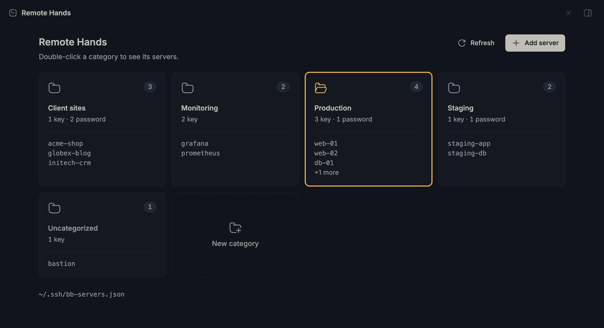
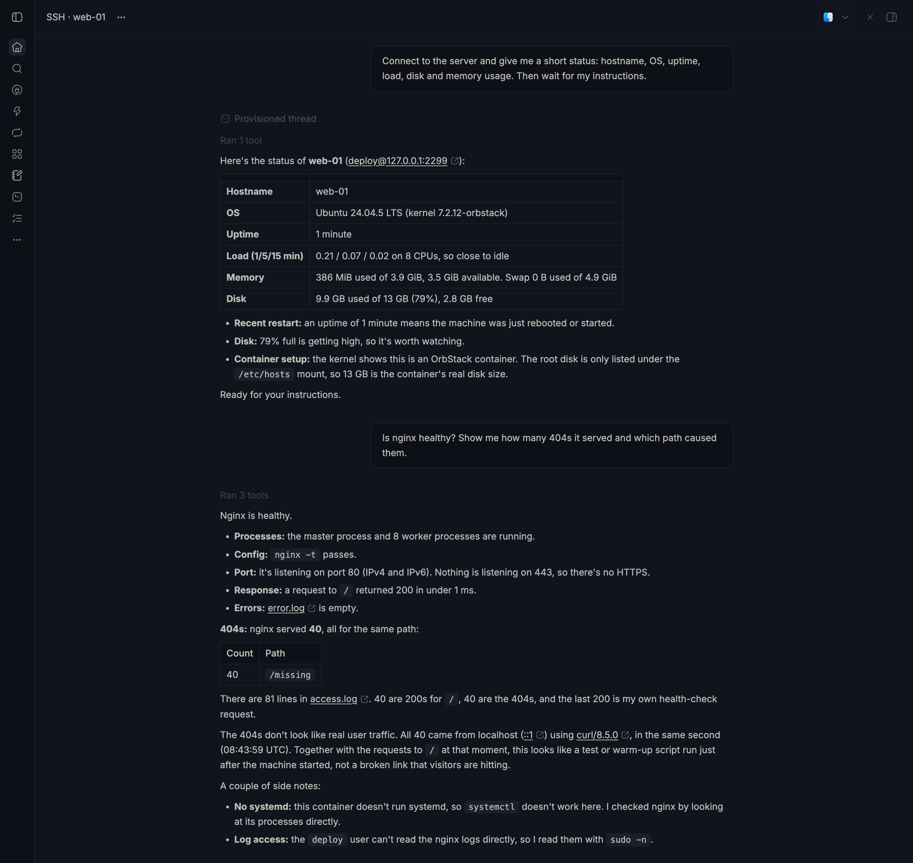
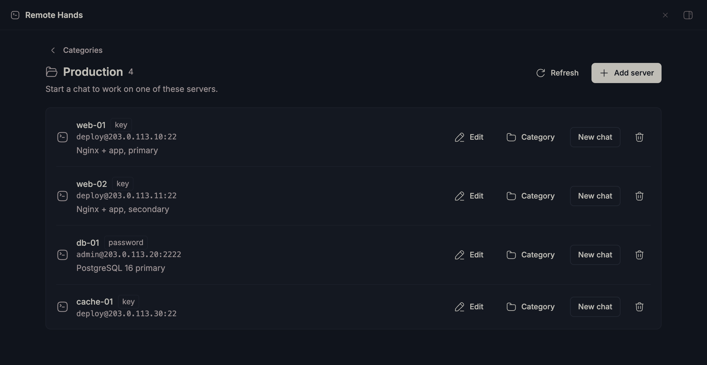
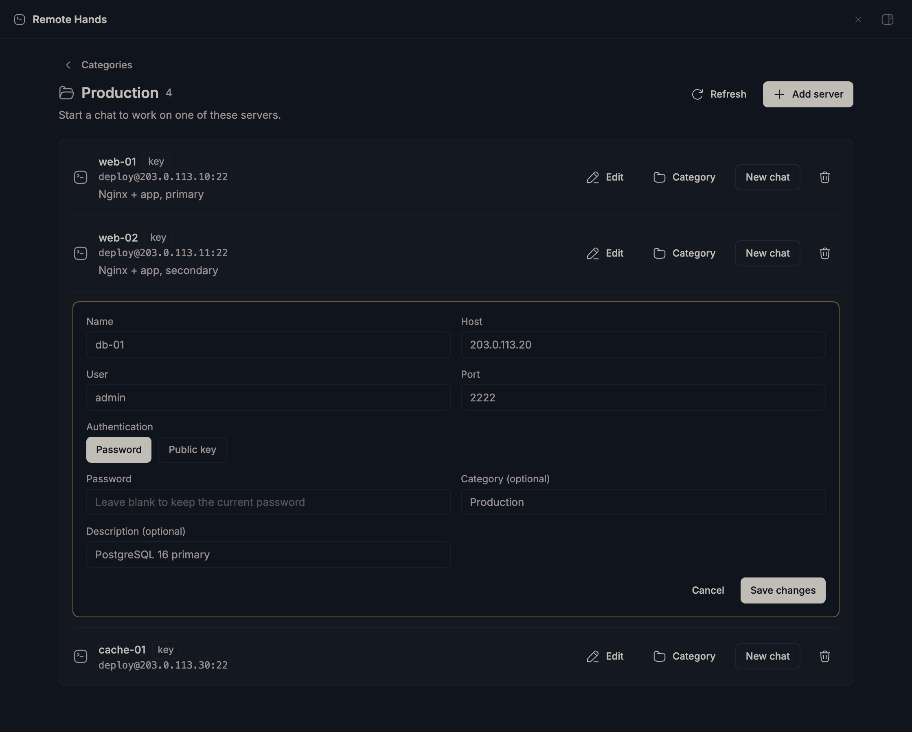
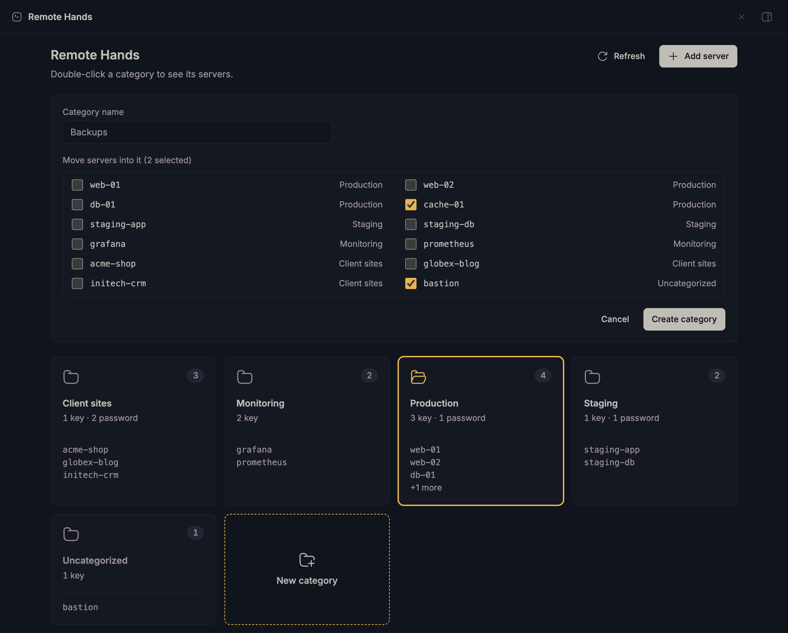

# Remote Hands for BB

Remote Hands keeps your SSH servers in one private file, groups them by
category, and opens an AI chat bound to one server. The agent in that chat runs
commands on the server through the `ssh_exec` tool, so you can ask it to check,
fix, or deploy anything there.



## Screenshots

The screenshots use dummy servers. The chat ran against a throwaway Ubuntu
container named `web-01`.

**An AI chat on a server.** New chat connects the agent to `web-01`. It reports
the server's status, then answers a follow-up by checking nginx's processes,
config, and logs itself.



| Servers in a category | Editing a server |
| --- | --- |
|  |  |

| Creating a category |
| --- |
|  |

- **Categories.** The panel opens on a grid of categories. Click once to select
  one, and double-click or press Enter to open it. Escape goes back.
- **Servers.** Each row starts an AI chat on that server with **New chat**.
  **Edit** changes its details, **Category** moves it, and the bin removes it.
- **New category.** Name it and tick the servers to move in. An empty category
  stays until you delete it from its page.

## Installation

### Requirements

- bb 0.47 or newer.
- A bb server on macOS or Linux with OpenSSH 8.4 or newer. Password login
  relies on `SSH_ASKPASS_REQUIRE`, which arrived in 8.4. Run `ssh -V` to check.
- Network access from the bb server to your servers on their SSH ports.

### 1. Install the plugin

Install it from GitHub. bb clones the repository, installs its dependencies,
and builds it.

```sh
bb plugin install git:https://github.com/thisnugroho/remote-hands.git
```

To work on the plugin itself, install a local clone instead. bb then loads
the source in place.

```sh
git clone git@github.com:thisnugroho/remote-hands.git
cd remote-hands
npm install --include=dev --ignore-scripts
bb plugin install .
```

Open **Remote Hands** in the bb sidebar to check that it loaded.

### 2. Add your servers

Pick whichever fits:

- **From the panel.** Click **Add server** and fill in the name, host, user,
  port, and either a password or a key path.
- **From `~/.ssh/config`.** `bb ssh import` previews your existing hosts as key
  entries, and `bb ssh import --write` saves them.
- **From the terminal.** For example:
  `printf '%s' "$PW" | bb ssh add vps --host 192.0.2.10 --user ubuntu --mode password --password-stdin`.

### 3. Start a chat

Open a category, then click **New chat** on a server. The agent connects,
reports the server's status, and waits for instructions. It runs every command
for that server through the `ssh_exec` tool and asks before destructive steps
such as `rm -rf`, dropping a database, or a reboot.

### Update or remove

```sh
bb plugin update ssh
bb plugin remove ssh
```

Removing the plugin deletes its settings but leaves your servers file in place.

The plugin id is `ssh`, so its command is `bb ssh` and its settings live under
`bb plugin config ssh`.

## Servers file

Servers live in `~/.ssh/bb-servers.json` on the BB server. Set `serversFile`
with `bb plugin config ssh set serversFile /absolute/path/servers.json` to use
another path. Keep the file private with mode 0600, because it stores
passwords in plain text. See [the SSH skill](skills/ssh/SKILL.md) for the
format and the tool's limits.

## Commands

```sh
bb ssh path
bb ssh list --json
bb ssh import
bb ssh import --write
bb ssh add <name> --host <host> --user <user> [--port 22] [--mode key|password] [--key-path <path>] [--password-stdin]
bb ssh edit <name> [--new-name <name>] [--host <host>] [--port <port>] [--category <category>] ...
bb ssh remove <name>
bb ssh category <name> <category> | --clear
bb ssh list --category <category>
bb ssh new-category <name> [--server a,b]
bb ssh delete-category <name>
```

## Importing from `~/.ssh/config`

Import reads `~/.ssh/config` on the BB server. It imports concrete Host aliases
with their HostName, User, Port, and first IdentityFile. Earlier values win for
repeated aliases. It ignores wildcard blocks, Match blocks, Include directives,
and ProxyCommand. Missing HostName defaults to the alias. Missing User defaults
to the local account. Existing entries keep their credentials. Preview output
shows public fields, and the write preserves full entries in the private file.

## Security

Commands run through `/usr/bin/ssh`. Passwords and key passphrases reach
OpenSSH through an askpass helper and an environment variable, never through
command arguments. The panel, the CLI, and the agent only ever see public
fields. ControlMaster connections persist for ten minutes.

The plugin uses `StrictHostKeyChecking=accept-new`. OpenSSH records new host
keys and rejects changed keys. Key paths use OpenSSH's tilde expansion. The
askpass helper and the ControlMaster sockets live in a 0700
`/tmp/bb-ssh-<uid>` directory.

## Development

Use Node 22.18 or newer for TypeScript tests.

```sh
npm install --include=dev --ignore-scripts
npm test
npx tsc --noEmit
bb plugin build
```

The tests use temporary files and an isolated HOME for import. They do not
connect to remote servers or write the real SSH configuration. Install and
exercise the panel in BB to verify live navigation and agent integration.
